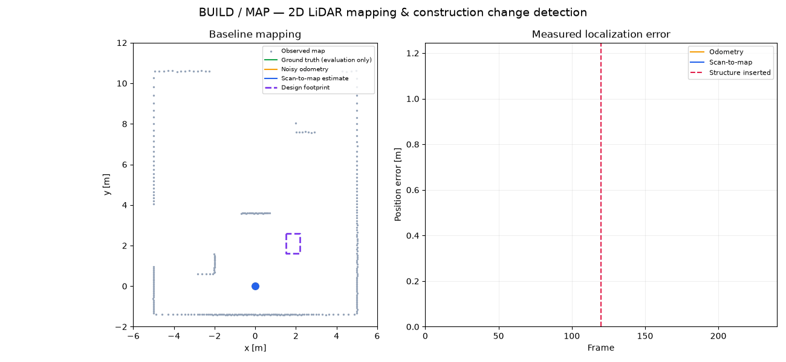
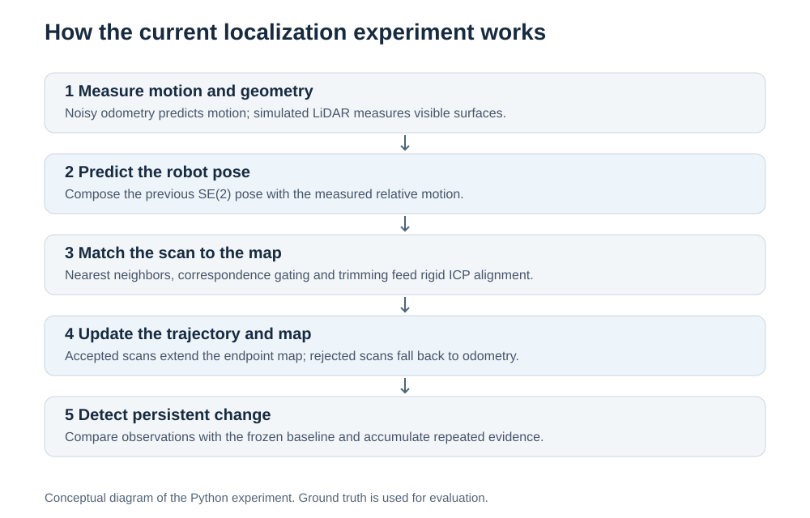
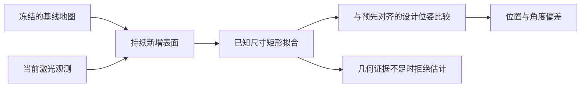

# BUILD / MAP

**2D LiDAR mapping, construction-change detection and design-based placement inspection.**

A simulated robot surveys a room twice. A new structural element appears during the second lap. The demo estimates its trajectory from noisy odometry and scan-to-map ICP, builds an endpoint point-cloud map, flags persistent surfaces absent from a frozen baseline, and fits a known-size rectangular element to estimate installation deviation from a pre-aligned design.




## 看图理解这个项目

机器人先观察房间，利用里程计预测运动，再用激光扫描与已有地图匹配，修正自己的位置。第二轮巡检时，场景中加入一个结构，系统寻找相对第一轮基线持续出现的新表面，并进一步估计构件的安装偏差。

### 演示应该看哪里

上方动画中，绿色是真值轨迹，橙色是带偏差的里程计，蓝色是扫描匹配修正后的轨迹，灰色点表示累积地图。红点表示相对冻结基线连续观测到的新增表面。第 120 帧开始加入新结构。右侧曲线展示定位误差。

观察三个问题：橙色轨迹如何逐渐偏离？蓝色轨迹怎样利用环境几何修正？新结构出现后，需要多少次观测才产生持续变化证据？

### 定位与建图如何连接



每一帧的定位结果决定激光点落在地图的什么位置。定位偏差会让墙面出现重影，也会影响变化检测。因此，本项目先评估定位，再讨论新增表面与构件偏差。

ICP 依赖运动预测提供的初值。距离门限与裁剪帮助筛除部分错误对应；走廊、低重叠和较大的初始误差仍可能使匹配失败。这里的地图保存激光端点，后续 ROS 2 路线将引入栅格地图作为导航输入。

### 当前示例的定位误差

| 相同初始坐标系下的位置 RMSE | Seed 7 |
|---|---:|
| 带偏差里程计 | 0.578 m |
| 扫描到地图匹配 | 0.017 m |

数值来自仓库的 [metrics.json](artifacts/metrics.json)，对应 240 帧合成场景。它展示这一场景中的表现，跨场景可靠性需要通过多种子、遮挡和几何退化实验继续评估。

### 下一步怎样使用 RViz 和 Gazebo


**Gazebo** 负责模拟机器人、环境和传感器。**ROS 2** 负责连接节点、消息和时间。**RViz** 用来检查传感器、坐标变换、地图和轨迹，可以贯穿整个调试过程。

先在 Gazebo 中确认机器人和激光正常工作，再检查 ROS 2 的 /scan、/odom、/clock 与 TF。接着用 SLAM Toolbox 建图并保存地图，最后重新加载地图，通过 AMCL 定位与 Nav2 导航验证它是否可用。

这一图展示计划中的集成流程。现有 ROS 2 适配器发布 /demo/path，运行验证与 Gazebo 集成仍待完成。逐步操作、验收材料和实验设计见 [中文研究路线](docs/RESEARCH_ROADMAP_ZH.md)。

### 从新增表面到安装偏差



连续出现的表面提供候选几何。构件检查进一步使用已知矩形尺寸，拟合位置和朝向，再与设计位姿比较。只有一个可见面时，某些方向上的位置可能难以确定，需要更多视角。

后续实验会分别测量定位误差、变化检测精确率与召回率、检测延迟，以及构件位置和角度误差。相关方法与限制见 [构件检查说明](docs/INSPECTION_ZH.md)。

## Research direction

This project investigates how scene changes affect LiDAR localization and how localization error propagates into construction-change detection and placement inspection.

The next experiments compare odometry, the current ICP front end, and SLAM Toolbox under controlled geometry changes, then measure detection precision, recall, latency, and placement error.

**[Step-by-step research roadmap 中文](docs/RESEARCH_ROADMAP_ZH.md)**

| Stage | Work | Evidence |
|---|---|---|
| Localization foundations | Reproduce SE(2), odometry and ICP experiments | Existing Python demo and tests |
| Controlled experiments | Multiple seeds, noise and geometry ablations | Planned experiment records |
| ROS 2 and RViz | Inspect messages, timestamps, TF and trajectories | Adapter exists; runtime verification pending |
| Gazebo integration | Simulated sensors, clock and rosbag recording | Planned |
| Mapping and localization | SLAM Toolbox mapping, map export, AMCL localization | Planned |
| Changing environments | Compare methods and quantify inspection errors | Planned |

Follow the roadmap for commands, acceptance criteria, evaluation definitions and experiment records. Gazebo and ROS 2 integration results will be added after execution.

## Run

Python 3.11 recommended. No ROS, GPU, or Gazebo required for this reproducible experiment.

```bash
python3 -m venv .demo-venv
source .demo-venv/bin/activate
pip install -r requirements-lock.txt
python -m construction_slam.demo --gif
python -m unittest discover -s tests -v
```

On the original workstation the prepared interpreter is `.demo-venv/bin/python`.
If system Python lacks `venv`, use an installed Python with venv support; this workstation used `/home/joe/anaconda3/bin/python`.

Outputs: `artifacts/demo.gif`, `overview.png`, `metrics.json`, `trajectory.csv`, `map_points.npy`, `construction_state.json`, `inspection_history.json`. Change the random seed with `--seed 42 --output artifacts/seed42`. GIF rendering is optional and takes longer than the numerical experiment.

## Architecture

```text
Ray-cast world → noisy LiDAR scans ───────────────┐
Simulated motion → biased noisy odometry → SE(2) prediction
                                                 ↓
                                   trimmed point-to-point ICP
                                                 ↓
                                  pose + voxel-filtered map
                                                 ↓
                         frozen baseline → persistent novel cells
Truth ───────────────────────────────→ evaluation only
```

- SE(2) transformations and motion composition.
- Nearest-neighbor ICP with SVD rigid alignment, correspondence gating and trimming.
- Incremental endpoint map with 6 cm voxel filtering; failed scans are not inserted.
- Baseline frozen after one lap; cells >30 cm from baseline need three consecutive observations.
- Shared-origin trajectory RMSE, CSV export, and reproducible animation.
- Known-size rectangle fitting with robust least squares, observability checks, translation/yaw tolerances and a planner-facing JSON report.
- [Design inspection details (中文)](docs/INSPECTION_ZH.md).

The estimator does not receive true poses or world geometry. Ground-truth motion generates synthetic noisy odometry, as part of the simulator; truth is also used for evaluation. Initial map frame is the first scan frame. The route and insertion time are scripted, not planned autonomously.

## Measured example

Seed 7, 240 frames, 360 rays per scan, 12 mm range noise, 3.5% translation bias plus odometry noise and heading bias:

| Metric | Result |
|---|---:|
| Odometry position RMSE | 0.578 m |
| Scan-to-map position RMSE | 0.017 m |
| Rejected scans | 0 |
| Peak persistent novel cells | 9 |

These are results in one simple synthetic scene, not real-robot accuracy claims. No post-hoc trajectory alignment is applied. Novel-cell count is not detection precision or recall.

## Scope and limitations

This is a small mapping/localization front end, **not a complete production SLAM system**. No loop closure, pose graph, covariance, IMU fusion, 3D reconstruction, multi-robot fusion, or navigation. The map contains occupied endpoints, not a free/occupied/unknown occupancy grid. New surfaces are added immediately to the evolving map; change detection separately compares against the frozen baseline. There is no semantic object recognition or removal detection. Design comparison is limited to one stationary known-size 2D rectangle in a pre-aligned frame; it is not CAD/BIM registration or 6DoF pose estimation. The JSON action is advisory; no planner is connected. Previously unseen static surfaces and localization errors can trigger false positives. Baseline freezing uses the scripted lap boundary. Motion is small and overlap is high; corridors, large jumps and low overlap can defeat ICP. Rejected frames fall back to odometry.

## Placement inspection

`config/design.json` defines the design pose, dimensions, and tolerances (8 cm / 5 degrees, demonstration values). The simulator deliberately adds 14.42 cm translation and 8 degrees rotation. Seed 7 estimates approximately 13.27 cm and 8.17 degrees and reports `deviation_detected`. Only scan-derived points enter the fitter. Insufficient geometry produces `insufficient_evidence`; stale observations request another view. Candidate association and quality gates are heuristic, with no probabilistic confidence guarantee.

## ROS2 / Gazebo extension

`ros2/scan_mapper.py` is an **experimental, runtime-unverified adapter** subscribing to `/scan` and `/odom` and publishing `/demo/path`. See [integration notes](docs/ROS2.md). The included simulation uses Python ray casting, not Gazebo.

## Learn and present

- [中文学习与面试指南](docs/LEARNING_ZH.md)
- [CV wording and application notes](docs/APPLICATION_ZH.md)
- [ROS2 integration scope](docs/ROS2.md)

Created with AI coding assistance as a learning scaffold. Review, reproduce, modify and explain the implementation before presenting it as personal project experience. Standard ICP is implemented here using NumPy/SciPy; no external SLAM package is wrapped.

## Publishing

See [GitHub instructions](docs/GITHUB_ZH.md). Source, configuration, tests, documentation and selected reproducible results belong in the repository; local virtual environments and caches do not.
