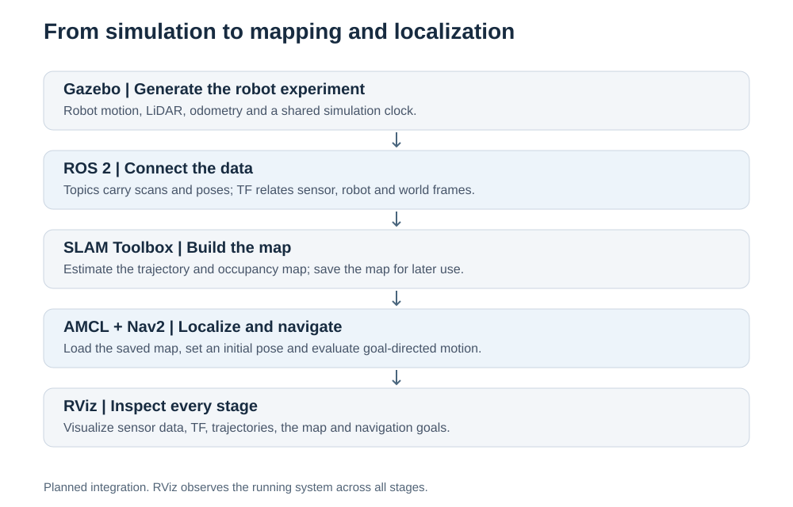
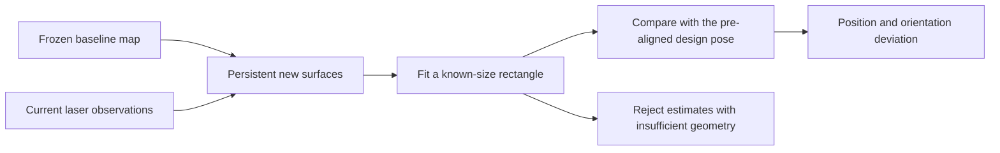

# BUILD / MAP

**2D LiDAR mapping, construction-change detection and design-based placement inspection.**

A simulated robot surveys a room twice. A new structural element appears during the second lap. The demo estimates its trajectory from noisy odometry and scan-to-map ICP, builds an endpoint point-cloud map, flags persistent surfaces absent from a frozen baseline, and fits a known-size rectangular element to estimate installation deviation from a pre-aligned design.


## Visual walkthrough

The robot observes a room, predicts its motion from odometry, and refines its pose by matching each laser scan against the accumulated map. During the second survey, a new structure appears. Repeated observations provide evidence of new surfaces and support placement inspection.

### Reading the animation

Green shows the ground-truth trajectory, orange shows biased odometry, blue shows the scan-matching estimate, and gray points show the accumulated map. Red points mark persistently observed surfaces absent from the frozen baseline. The new structure appears at frame 120. The right-hand plot tracks position error.

Watch how odometry drifts, how environmental geometry corrects the estimated trajectory, and how repeated observations accumulate evidence after the structure appears.

### Connecting localization and mapping


Each estimated pose determines where laser measurements enter the map. Pose errors can create duplicated wall surfaces and affect change detection. The experiment therefore evaluates localization before interpreting structural changes.

ICP uses the motion prediction as its initial estimate. Correspondence gating and trimming reduce some incorrect matches. Corridors, low scan overlap and large initial errors remain challenging. The current map stores laser endpoints; the planned ROS 2 workflow introduces occupancy grids for navigation.

### Example localization results

| Position RMSE in the shared initial frame | Seed 7 |
|---|---:|
| Biased odometry | 0.578 m |
| Scan-to-map estimate | 0.017 m |

These values come from a 240-frame synthetic run. Multiple seeds, occlusions and degenerate geometry are needed to evaluate reliability across conditions. See the saved [experiment metrics](artifacts/metrics.json).

### Working toward RViz and Gazebo



**Gazebo** simulates the robot, environment and sensors. **ROS 2** connects nodes, messages and simulation time. **RViz** visualizes sensor data, transforms, maps and trajectories throughout debugging.

The integration sequence starts with a working simulated robot and laser, followed by checks of /scan, /odom, /clock and TF. SLAM Toolbox then builds a map. A subsequent run loads the saved map for AMCL localization and Nav2 navigation.

**Screenshot status** — This repository currently contains the Python simulation animation and result plot. Project-specific RViz and Gazebo screenshots are pending runtime integration and validation.

The next capture set will show the Gazebo robot and environment, RViz laser scans and TF, the completed occupancy map, and localization against the reloaded map. Each capture should identify the software versions, launch command and experiment stage.

The current experimental ROS 2 adapter publishes /demo/path. Runtime validation and Gazebo integration remain pending. Follow the [integration notes](docs/ROS2.md) and [detailed research roadmap in Chinese](docs/RESEARCH_ROADMAP_ZH.md).

### From new surfaces to placement error



Persistent surfaces provide candidate geometry. Placement inspection fits a rectangle of known dimensions and compares its position and orientation with the design pose. A single visible face can leave some pose components weakly constrained, motivating additional viewpoints.

Planned experiments measure localization error, change-detection precision and recall, detection latency, and placement error. Method details and observability limits are documented in the [placement inspection guide in Chinese](docs/INSPECTION_ZH.md).

## Research direction

This project investigates how scene changes affect LiDAR localization and how localization error propagates into construction-change detection and placement inspection.

The next experiments compare odometry, the current ICP front end, and SLAM Toolbox under controlled geometry changes, then measure detection precision, recall, latency, and placement error.

**[Step-by-step research roadmap (Chinese)](docs/RESEARCH_ROADMAP_ZH.md)**

| Stage | Work | Evidence |
|---|---|---|
| Localization foundations | Reproduce SE(2), odometry and ICP experiments | Existing Python demo and tests |
| Controlled experiments | Multiple seeds, noise and geometry ablations | Planned experiment records |
| ROS 2 and RViz | Inspect messages, timestamps, TF and trajectories | Adapter exists; runtime verification pending |
| Gazebo integration | Simulated sensors, clock and rosbag recording | Planned |
| Mapping and localization | SLAM Toolbox mapping, map export, AMCL localization | Planned |
| Changing environments | Compare methods and quantify inspection errors | Planned |

Follow the roadmap for commands, acceptance criteria, evaluation definitions and experiment records. Gazebo and ROS 2 integration results will be added after execution.

## Run

Python 3.11 recommended. No ROS, GPU, or Gazebo required for this reproducible experiment.

```bash
python3 -m venv .demo-venv
source .demo-venv/bin/activate
pip install -r requirements-lock.txt
python -m construction_slam.demo --gif
python -m unittest discover -s tests -v
```

On the original workstation the prepared interpreter is `.demo-venv/bin/python`.
If system Python lacks `venv`, use an installed Python with venv support; this workstation used `/home/joe/anaconda3/bin/python`.

Outputs: `artifacts/demo.gif`, `overview.png`, `metrics.json`, `trajectory.csv`, `map_points.npy`, `construction_state.json`, `inspection_history.json`. Change the random seed with `--seed 42 --output artifacts/seed42`. GIF rendering is optional and takes longer than the numerical experiment.

## Architecture

```text
Ray-cast world → noisy LiDAR scans ───────────────┐
Simulated motion → biased noisy odometry → SE(2) prediction
                                                 ↓
                                   trimmed point-to-point ICP
                                                 ↓
                                  pose + voxel-filtered map
                                                 ↓
                         frozen baseline → persistent novel cells
Truth ───────────────────────────────→ evaluation only
```

- SE(2) transformations and motion composition.
- Nearest-neighbor ICP with SVD rigid alignment, correspondence gating and trimming.
- Incremental endpoint map with 6 cm voxel filtering; failed scans are not inserted.
- Baseline frozen after one lap; cells >30 cm from baseline need three consecutive observations.
- Shared-origin trajectory RMSE, CSV export, and reproducible animation.
- Known-size rectangle fitting with robust least squares, observability checks, translation/yaw tolerances and a planner-facing JSON report.
- [Design inspection details (Chinese)](docs/INSPECTION_ZH.md).

The estimator does not receive true poses or world geometry. Ground-truth motion generates synthetic noisy odometry, as part of the simulator; truth is also used for evaluation. Initial map frame is the first scan frame. The route and insertion time are scripted, not planned autonomously.

## Measured example

Seed 7, 240 frames, 360 rays per scan, 12 mm range noise, 3.5% translation bias plus odometry noise and heading bias:

| Metric | Result |
|---|---:|
| Odometry position RMSE | 0.578 m |
| Scan-to-map position RMSE | 0.017 m |
| Rejected scans | 0 |
| Peak persistent novel cells | 9 |

These are results in one simple synthetic scene, not real-robot accuracy claims. No post-hoc trajectory alignment is applied. Novel-cell count is not detection precision or recall.

## Scope and limitations

This is a small mapping/localization front end, **not a complete production SLAM system**. No loop closure, pose graph, covariance, IMU fusion, 3D reconstruction, multi-robot fusion, or navigation. The map contains occupied endpoints, not a free/occupied/unknown occupancy grid. New surfaces are added immediately to the evolving map; change detection separately compares against the frozen baseline. There is no semantic object recognition or removal detection. Design comparison is limited to one stationary known-size 2D rectangle in a pre-aligned frame; it is not CAD/BIM registration or 6DoF pose estimation. The JSON action is advisory; no planner is connected. Previously unseen static surfaces and localization errors can trigger false positives. Baseline freezing uses the scripted lap boundary. Motion is small and overlap is high; corridors, large jumps and low overlap can defeat ICP. Rejected frames fall back to odometry.

## Placement inspection

`config/design.json` defines the design pose, dimensions, and tolerances (8 cm / 5 degrees, demonstration values). The simulator deliberately adds 14.42 cm translation and 8 degrees rotation. Seed 7 estimates approximately 13.27 cm and 8.17 degrees and reports `deviation_detected`. Only scan-derived points enter the fitter. Insufficient geometry produces `insufficient_evidence`; stale observations request another view. Candidate association and quality gates are heuristic, with no probabilistic confidence guarantee.

## ROS2 / Gazebo extension

`ros2/scan_mapper.py` is an **experimental, runtime-unverified adapter** subscribing to `/scan` and `/odom` and publishing `/demo/path`. See [integration notes](docs/ROS2.md). The included simulation uses Python ray casting, not Gazebo.

## Learn and present

- [Learning and interview guide (Chinese)](docs/LEARNING_ZH.md)
- [CV wording and application notes](docs/APPLICATION_ZH.md)
- [ROS2 integration scope](docs/ROS2.md)

Created with AI coding assistance as a learning scaffold. Review, reproduce, modify and explain the implementation before presenting it as personal project experience. Standard ICP is implemented here using NumPy/SciPy; no external SLAM package is wrapped.

## Publishing

See [GitHub instructions](docs/GITHUB_ZH.md). Source, configuration, tests, documentation and selected reproducible results belong in the repository; local virtual environments and caches do not.
